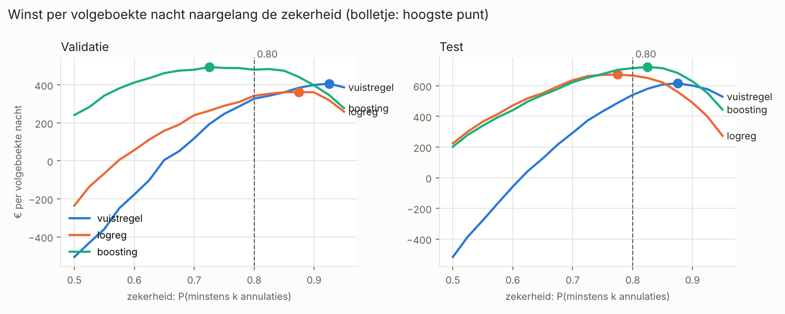
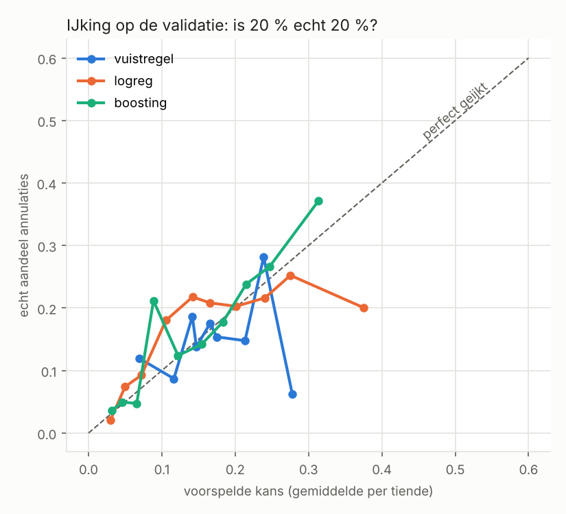

# Overboeken per hotel-nacht op basis van annulatiekansen

Cloud for AI, 2026-2027. Kynan Melsens

Een hotel beslist 30 dagen vóór elke nacht hoeveel kamers het extra mag verkopen. Dit model
voorspelt per boeking die op dat moment nog actief is, hoe groot de kans is dat ze alsnog
geannuleerd wordt of een no-show wordt. Opgeteld per nacht geeft dat het verwachte aantal
kamers dat vrijkomt, en daaruit een advies: overboek k kamers. Het model adviseert, de revenue
manager beslist.

## In het kort

- **Model:** `HistGradientBoostingClassifier`, zonder het land als feature
- **Gekozen op** de MAE van het aantal annulaties per hotel-nacht, op de validatie (Q1 2017):
  4,86 tegenover 6,36 voor de vuistregel van de revenue manager. Op de test (april tot
  augustus 2017, één keer gemeten): 5,11 tegenover 6,04
- **Split** in de tijd, op aankomstdatum, met een embargo van 31 dagen
- **Poort:** een model wordt alleen weggeschreven als het de vuistregel verslaat op de
  validatie, en een AUC van minstens 0,60 haalt
- **Advies k:** het grootste aantal waarvoor P(minstens k annulaties) ≥ 0,80, nooit meer dan
  5 % van de capaciteit
- **Belangrijkste bevinding:** het land is waarschijnlijk pas na het beslismoment ingevuld, en
  dus een lek. Het staat uit. Zie [Bevindingen](#bevindingen)

## Draaien

Python 3.10 of nieuwer (getest met 3.13). Draai alles **vanuit deze map**, niet vanuit `src/`.
Anders vindt Python het pakket niet.

```bash
python -m venv .venv
.venv\Scripts\activate          # macOS/Linux: source .venv/bin/activate
pip install -r requirements.txt

pytest                          # 82 tests, allemaal groen, ±30 s
ruff check . ; ruff format --check .   # stijl en opmaak, allebei schoon
python -m src.train             # traint model.soort, test de poorten, schrijft models/
python -m src.predict data/nieuwe_boekingen.csv                  # kansen en advies k
python -m src.evaluate          # alle modellen per hotel-nacht, schrijft naar resultaten/
```

Wat `src.predict` geeft voor het voorbeeldbestand:

```
76 boekingen. Gemiddelde kans op annuleren: 12.6%
Verwacht aantal annulaties: 9.6

Advies voor de nacht van 15-08-2017 (zekerheid 80%):
  City Hotel     62 boekingen, verwacht 8.5 annulaties: overboek 3 kamer(s) (maximum 11)
  Resort Hotel   14 boekingen, verwacht 1.1 annulaties: overboek 0 kamer(s) (maximum 9)
```

Nog een paar mogelijkheden:

```bash
python -m src.predict data/nieuwe_boekingen.csv --nacht 2017-08-16   # een andere nacht
python -m src.predict data/nieuwe_boekingen.csv --zonder-schema      # alleen voor diagnose
python -m src.train --config pad/naar/config.yaml                    # een andere config
jupyter nbconvert --to notebook --execute --inplace notebooks/01_exploratie.ipynb
```

`src.predict` neemt ook `--config`. De systeemtest gebruikt dat om in een tijdelijke map te
werken. Het notebook staat er met de uitvoer in: lezen kan zonder het te draaien, bijvoorbeeld
in VS Code of op GitHub. De laatste regel draait het opnieuw.

## Data

`data/hotel_bookings.csv` is *Hotel booking demand* van Kaggle
(kaggle.com/datasets/jessemostipak/hotel-booking-demand): 119 390 boekingen van een
stadshotel in Lissabon en een resort in de Algarve, met aankomst tussen juli 2015 en augustus
2017.

Bron: Antonio, N., de Almeida, A. & Nunes, L. (2019). Hotel booking demand datasets.
*Data in Brief, 22*, 41–49. https://doi.org/10.1016/j.dib.2018.11.126. Licentie CC BY 4.0.

Er staan geen namen of contactgegevens in. `country` gebruikt het model niet: de kolom is
waarschijnlijk pas na het beslismoment ingevuld (zie [Bevindingen](#bevindingen)).

`data/nieuwe_boekingen.csv` is geldige voorbeeldinvoer om te voorspellen: de 76 boekingen die
op 16 juli 2017 nog actief waren en op 15 augustus 2017 aankomen, zonder hun afloop. Gasten die
eerder aankwamen en die nacht nog blijven, zitten er niet in. In productie zou de export van het
beslismoment alle actieve boekingen van die nacht bevatten.

### Exploratie

`notebooks/01_exploratie.ipynb` verantwoordt de keuzes in `src/`: wat er in de data zit, wat er
stuk aan is en wat eraan gedaan is, Non Refund, het label, een lekcontrole per kolom, het land,
de capaciteit en waarom annulaties per nacht breder spreiden dan losse annulaties. Het notebook
verandert zelf niets aan de data: alles gebeurt in de code, zodat training en voorspellen
dezelfde stappen doorlopen. Enkele vaststellingen:

- **Dubbele rijen.** 27 % van de rijen is een exacte kopie van een andere. Zonder boekingsnummer
  is dat niet te onderscheiden van een tweede kamer in dezelfde groep. Ze blijven staan, en ze
  kunnen niet over de split lekken: kopieën hebben dezelfde aankomstdatum.
- **Non Refund.** 99,4 % staat als geannuleerd, 97 % is Portugees, 97 % zijn groepen of
  touroperators, en maar 93 van de 14 587 checkten uit. Dat is geen gedrag maar een
  eigenaardigheid van de export. Ze gaan eruit.
- **Kolommen die pas bij aankomst ingevuld worden.** Een parkeerplaats, een andere kamer dan
  gereserveerd, wijzigingen en speciale wensen. Van de 3 265 actieve boekingen met een
  parkeerplaats annuleert er niet één. Geen van die kolommen is een feature.
- **Annulaties komen samen.** 22 % van de late annulaties valt samen met minstens vier
  identieke boekingen, met groepen tot 60. Daarom de spreidingsfactor.

## Van ruwe export naar trainingsset

1. **Valideren** (`src/schema.py`): de csv moet aan het schema voldoen, anders stopt alles.
2. **Opschonen** (`schoon_op()` in `src/data.py`): de boekingen buiten scope gaan eruit. Dat zijn
   `Non Refund`, een `adr` van 0 of minder of van 1 000 of meer, en verblijven van nul nachten.
3. **Label** (`maak_label()`): alleen boekingen die 30 dagen vóór aankomst nog actief zijn.
   Label 1 als ze daarna alsnog geannuleerd worden of een no-show worden. Er blijven
   50 824 boekingen over, met een basiskans van 14,3 %.

De horizon en de opschoningsgrenzen staan in `configs/default.yaml`.

Bewust geen feature, omdat ze pas na het beslismoment gekend zijn of dat vermoedelijk zijn:
`reservation_status(_date)` (het label), `assigned_room_type`, `booking_changes`,
`required_car_parking_spaces`, `total_of_special_requests`, `days_in_waiting_list` en
`country`. De lekcontrole per kolom staat in het notebook.

### Het schema

Twee schema's: `INVOER` (een boeking zoals het boekingssysteem ze exporteert) en `TRAINING`
(dezelfde export plus de eindstatus). Per kolom ligt het type vast, net als het bereik, de
toegelaten waarden en of ze leeg mag zijn. `TRAINING` controleert ook de dataset als geheel:
de mediaan van `adr`, de mediaan van `lead_time`, en het aandeel annulaties en no-shows. Dat
aandeel moet tussen 20 en 50 % liggen; in de export is het 37 %.

Wat het schema tegenhoudt, en wat niet:

| Fout | Gestopt? | Door welke controle |
|---|---|---|
| kolom hernoemd (`adr` → `adr_eur`) | ja | de kolom ontbreekt |
| `adr` in cent | ja | `adr < 10 000` per rij, en de mediaan |
| `lead_time` in uren | ja | `lead_time` tussen 0 en 3 jaar, en de mediaan |
| `lead_time` in weken | alleen bij training | de mediaan. Per rij blijft alles binnen het bereik |
| iedereen op `Canceled` | ja | het aandeel annulaties. Per rij is elke status geldig |
| alleen wie uitcheckte, of de meeste annulaties eruit gefilterd | ja | het aandeel annulaties |
| `adr` in dollar | nee | ligt te dicht bij de euro voor een vast bereik |
| `adr` per verblijf in plaats van per nacht | nee | blijft binnen bereik en mediaan |

Wat ontbreekt voor de laatste twee: een vergelijking van de verdeling met die van de
trainingsdata, in plaats van een vaste grens. Dat is driftbewaking, voor deel 3. Bij
voorspellen controleert het schema alleen per rij: één boeking heeft geen mediaan.

Zonder schema geeft een export in centen stil onzin: het voorbeeldbestand krijgt dan 0,0 %
kans op annuleren, en het hotel zou nooit overboeken.

## De split: in de tijd, op aankomstdatum

| Deel | Aankomst | Boekingen | Annuleert | Waarvoor |
|---|---|---|---|---|
| training | 01-07-2015 tot 30-11-2016 | 31 840 | 14,9 % | het model leren |
| validatie | 01-01-2017 tot 31-03-2017 | 4 439 | 16,6 % | het model kiezen, de poorten, de spreidingsfactor |
| hertraining | 01-07-2015 tot 28-02-2017 | 35 629 | 15,5 % | het gekozen model opnieuw leren |
| test | 01-04-2017 tot 31-08-2017 | 13 064 | 11,5 % | één keer meten, alleen rapporteren |

Een willekeurige split laat de toekomst in de training lekken: een boeking van augustus 2017
helpt dan een boeking van januari 2017 voorspellen. Daarom wordt op aankomstdatum gesplitst.
Met de willekeurige split haalde de logistische regressie een AUC van 0,725, met de split in de
tijd 0,628. Het verschil was lek.

Tussen training en validatie zit een **embargo**. Op 2 december beslis je voor 1 januari. De
afloop van boekingen met aankomst in december ken je dan nog niet, dus die mogen niet in de
training. Een no-show ken je pas de dag na aankomst, vandaar nog een dag extra. De training
stopt dus op 30 november. Hetzelfde geldt voor de hertraining vóór de test: die stopt op
28 februari. De datums staan in `configs/default.yaml`, het embargo rekent `grenzen()` in
`src/train.py` uit. `tests/test_split.py` controleert het met de aankomstdatums zelf.

Het model wordt gekozen en tegengehouden op de validatie. Daarna wordt het opnieuw getraind
op de hertraining, omdat het hotel in de praktijk ook de recentste data zou gebruiken, en één
keer op de test gemeten. Op de test wordt niets gekozen.

## De modellen

| `model.soort` | Wat |
|---|---|
| `vuistregel` | de baseline, wat de revenue manager vandaag doet (`src/baseline.py`) |
| `logreg` | logistische regressie: lege waarden invullen, schalen, one-hot-encoderen |
| `boosting` | `HistGradientBoostingClassifier`, met de categorieën als categorieën. Zonder vroege stop, want die zet een willekeurig stuk van de training apart |

De **vuistregel** neemt het annulatiepercentage van het afgelopen jaar, per hotel ×
`market_segment` × klasse van `lead_time` (<60, 60–120, 120–240, 240+ dagen). Een groep met
minder dan 30 boekingen krijgt het percentage van het hotel. Met `venster_maanden: null`
gebruikt ze alle historiek. Op de validatie overschat ze dan minder (1,05 tegenover 1,10), op de
test meer (1,30 tegenover 1,20). Het venster van 12 maanden is vooraf vastgelegd, niet afgesteld.

Alles wat iets leert uit de data zit ín de pijplijn, ook het groeperen van het land
(`land_als_groep` in `src/kenmerken.py`). Ruwe rijen uit het boekingssysteem gaan er dus
rechtstreeks in.

### Wisselen van model

Eén sleutel in `configs/default.yaml`, en daarna opnieuw trainen:

```yaml
model:
  soort: boosting      # vuistregel | logreg | boosting
features:
  gebruik_land: false  # true: het land als PRT tegenover de rest
```

```bash
python -m src.train
```

`src.train` traint wat in de config staat, en schrijft het alleen weg als het door de poorten
komt. `soort: vuistregel` komt er dus nooit door: ze kan zichzelf niet verslaan. Om alle
modellen te vergelijken, hoef je de config niet aan te passen: `python -m src.evaluate`
draait ze allemaal, met en zonder land.

## Evaluatie per hotel-nacht

### Van kansen naar een advies

1. **Per nacht tellen.** Een boeking telt mee in elke nacht van haar verblijf. Per hotel-nacht
   is het verwachte aantal annulaties de som van de kansen, en de variantie de som van
   p × (1 − p). Het label blijft verankerd op de aankomst: dat is een vereenvoudiging.
2. **Spreidingsfactor.** Boekingen annuleren niet los van elkaar, want een groep annuleert
   samen. De spreiding wordt daarom vermenigvuldigd met een factor per hotel en per model,
   geschat op de validatie: de wortel uit het gemiddelde van (echt − verwacht)² / variantie,
   met een minimum van 1. Voor boosting is dat 2,6 voor City en 1,5 voor Resort.
3. **Advies k.** Het grootste aantal waarvoor P(minstens k annulaties) ≥ 0,80, met een
   normale benadering. Nooit meer dan 5 % van de capaciteit: de bescherming voor de gast.
4. **Capaciteit.** De dataset zegt niet hoeveel kamers er zijn. Daarom het 99ste percentiel
   van de bezette kamers per nacht in de training, uit alle uitgecheckte boekingen. City komt
   op 226 kamers, Resort op 184. Het maximum per nacht is dus 11 en 9 kamers. Een nacht telt
   als volgeboekt vanaf 95 % van de capaciteit.
5. **Bedragen.** Elke kamer die echt vrijkomt en die je extra verkocht, levert r × adr op.
   Elke gast te veel kost W × adr: die moet je doorverwijzen naar een ander hotel. Met r = 0,5
   en W = 2 loont de k-de kamer zolang P(minstens k) ≥ W / (r + W) = 0,80. Daar komt de
   drempel vandaan.

Dezelfde functie (`met_advies()` in `src/nachten.py`) geeft het advies in de evaluatie en in
`src.predict`. Wat geëvalueerd wordt, is dus wat het hotel te zien krijgt.

### Resultaten

`python -m src.evaluate` schrijft alles naar `resultaten/`: `evaluatie.csv` (per model en per
hotel, met de gevoeligheid voor r = 0,3 en W = 3), `groepen.csv`, `winstcurve.csv`,
`winstcurve.png` en `ijking.png`. Hieronder beide hotels samen.

Validatie (Q1 2017, 31 volgeboekte nachten). Hier wordt gekozen:

| Model | MAE | voorspeld/echt | € per volgeboekte nacht | doorverwezen per volle nacht |
|---|---|---|---|---|
| vuistregel | 6,36 | 1,13 | 342 | 0,23 |
| logreg zonder land | 5,78 | 0,94 | 349 | 0,10 |
| **boosting zonder land** | **4,86** | 0,91 | 345 | 0,16 |
| logreg met land | 5,16 | 0,80 | 339 | 0,06 |
| boosting met land | 4,71 | 0,80 | 342 | 0,06 |

Test (april tot augustus 2017, 204 volgeboekte nachten, na hertrainen). Alleen gerapporteerd:

| Model | MAE | voorspeld/echt | € per volgeboekte nacht | doorverwezen per volle nacht |
|---|---|---|---|---|
| vuistregel | 6,04 | 1,24 | 630 | 0,11 |
| logreg zonder land | 5,41 | 1,06 | 576 | 0,07 |
| **boosting zonder land** | **5,11** | 1,07 | 617 | 0,08 |
| logreg met land | 5,03 | 0,87 | 491 | 0,00 |
| boosting met land | 5,49 | 1,00 | 532 | 0,01 |

**Gekozen: boosting zonder land**, op de laagste MAE op de validatie van de modellen zonder land.
Het is ook op de test het beste model zonder land. De modellen met land staan er ter
vergelijking: waarom ze niet in aanmerking komen, staat in bevinding 1.

| AUC | validatie | test |
|---|---|---|
| vuistregel | 0,548 | 0,611 |
| logreg zonder land | 0,628 | 0,626 |
| boosting zonder land | 0,687 | 0,653 |

### De poorten vóór het wegschrijven

`python -m src.train` schrijft het model alleen weg als het op de validatie

1. een lagere MAE per hotel-nacht heeft dan de vuistregel. Anders heeft het model geen reden
   om te bestaan. Boosting: 4,86 tegenover 6,36
2. een AUC van minstens 0,60 haalt (`minimum_auc`). Een model daaronder rangschikt de
   boekingen nauwelijks beter dan toeval. Boosting: 0,687

Haalt het een poort niet, dan stopt `src.train` met een melding en schrijft het niets weg.
Haalt het ze wel, dan wordt het opnieuw getraind op de hertraining, één keer op de test
gemeten, en weggeschreven. Naast `models/model.joblib` komt `models/advies.json`: de
spreidingsfactor per hotel (van de validatie) en de capaciteit per hotel (van de training).
Die heeft `src.predict` nodig voor k. De poorten staan in `bouw_en_bewaar()` in `src/train.py`,
en `tests/test_systeem.py` controleert dat een model dat ze niet haalt niets achterlaat.

## Bevindingen

### 1. Het land is waarschijnlijk een lek. Daarom staat het uit

In het voorstel stond het land als feature, gegroepeerd tot PRT tegenover de rest. Het doet
de AUC met 0,10 stijgen (boosting 0,687 → 0,785), en in de lekcontrole is het de sterkste
kolom na het label zelf. Dat is te mooi om het zonder controle te geloven. Als het land pas bij
het inchecken ingevuld wordt, en anders op Portugal blijft staan, dan vertelt het niet waar de
gast vandaan komt, maar of hij is komen opdagen. Dat is het label zelf.

Wat de data zegt, voor de boekingen die actief zijn op het beslismoment:

| | aandeel PRT |
|---|---|
| uitgecheckt | 18 % |
| geannuleerd na het beslismoment | 52 % |
| no-show | 63 % |

- Een no-show is nooit aangekomen, en is toch voor 63 % Portugees.
- Van de geannuleerde groepsboekingen is 99 % Portugees, van de uitgecheckte 26 %.
  Groepsboekingen van buiten Portugal annuleren 0,2 % van de tijd.
- Hetzelfde patroon bij Offline TA/TO (89 % tegenover 20 %) en Corporate (94 % tegenover
  52 %). Bij Online TA, waar de gast zelf boekt, is het veel zwakker (29 % tegenover 12 %).
- 14 176 van de 14 587 Non Refund-boekingen zijn Portugees, en 99,4 % daarvan is geannuleerd.
  Dat past bij hetzelfde mechanisme.

Dat is geen bewijs, want het boekingssysteem zelf kan je niet bevragen. Maar alle signalen
wijzen dezelfde kant op, en een lek kost meer dan een feature die je mist. Daarom staat
`gebruik_land` op `false`. Met `true` kan je het model met land nog altijd vergelijken.

Op de MAE per hotel-nacht helpt het land trouwens weinig: op de validatie 4,71 tegenover 4,86,
op de test zelfs slechter (5,49 tegenover 5,11).

### 2. De controle per groep (PRT tegenover de rest) is zelf aangetast

Voorspeld/echt aantal annulaties per groep:

| Model | PRT validatie | rest validatie | PRT test | rest test |
|---|---|---|---|---|
| vuistregel | 0,54 | 1,38 | 0,40 | 1,73 |
| boosting zonder land | 0,38 | 1,15 | 0,32 | 1,58 |
| boosting met land | 0,86 | 0,74 | 0,73 | 1,22 |

Zonder land onderschat elk model de Portugese boekingen sterk en overschat het de rest. Als
bevinding 1 klopt, is dat geen eerlijkheidsprobleem van het model, maar van de groepsindeling:
"Portugees" betekent dan deels "is niet komen opdagen". Een eerlijke controle per groep
vraagt een land dat bij het boeken gekend is. Die kolom bestaat niet in deze export.

### 3. De MAE verbetert, de euro's niet

Boosting verslaat de vuistregel op de MAE, op de validatie en op de test. In euro per
volgeboekte nacht is er nauwelijks verschil, en op de test verdient de vuistregel zelfs het
meest (630 tegenover 617). Twee oorzaken:

- **Het maximum van 5 % beslist, niet het model.** In City ligt het gemiddelde advies op de
  test tussen 10,7 en 11,0 van de 11 kamers, voor elk model. Op een volgeboekte nacht in de
  zomer annuleren er veel meer dan 11. Het model kan daar dus weinig verschil maken.
- **Het advies is voorzichtig.** Het doel is dat op hoogstens 20 % van de nachten minder
  annulaties zijn dan k. In werkelijkheid is dat 1 à 8 %. De spreidingsfactor vangt ook de
  fout van het model op, en niet alleen groepen die samen annuleren. De vuistregel overschat,
  geeft daardoor hogere k, en dat loont net omdat het advies zo voorzichtig is.

Het maximum per nacht is de grootste hefboom op de opbrengst, en het is een keuze om de gast
te beschermen, geen technisch gegeven.

### 4. Het hoogste punt van de winstcurve ligt dicht bij 0,80, maar de curve is vlak



| Model | top validatie | top test |
|---|---|---|
| vuistregel | 0,825 | 0,800 |
| logreg | 0,725 | 0,600 |
| boosting | 0,850 | 0,725 |

Tussen 0,6 en 0,85 verandert de winst weinig, omdat het maximum per nacht vaak bindt. Boven
0,85 zakt ze snel. 0,80 blijft dus een verdedigbare keuze. Het punt wordt niet op de test
gekozen.

### 5. IJking: ruwweg juist, met ruis



Elk punt is een tiende van de validatie, ongeveer 440 boekingen. Logreg en boosting volgen de
diagonaal ruwweg tussen 5 en 30 %, met uitschieters. Logreg is bovenaan te zeker: in de
hoogste tiende voorspelt het 37 % en annuleert 20 %. De vuistregel heeft maar een handvol
verschillende kansen en volgt de diagonaal het slechtst. In totaal onderschat boosting het
aantal annulaties per nacht op de validatie met 9 % en overschat het op de test met 7 %. Dat
de fout van teken wisselt tussen winter en zomer, wijst eerder op het seizoen dan op de
ijking.

## Grenzen

Wat dit project niet doet, of vereenvoudigt:

- **Het label hangt aan de aankomst.** Het beslismoment ligt 30 dagen vóór de aankomst, niet
  30 dagen vóór elke nacht. Voor de latere nachten van een lang verblijf beslist het model dus
  met informatie van iets vroeger dan nodig.
- **De capaciteit is geschat.** De dataset zegt niet hoeveel kamers er zijn. Kamers die nooit
  verkocht werden, zie je niet.
- **De spreidingsfactor meet twee dingen.** Groepen die samen annuleren, en de fout van het
  model. Herijken op de validatie zou die twee kunnen scheiden.
- **De validatie is laagseizoen.** 31 volgeboekte nachten zijn weinig om de euro's op te
  vergelijken. Daarom wordt gekozen op de MAE, die alle 180 hotel-nachten gebruikt.
- **Het weeknummer** scoort in de lekcontrole hoger dan de maand en is bij het boeken gekend.
  Het is een kandidaat-feature die nog niet getest is.
- **Driftbewaking, een API en Docker** horen bij deel 3.

## Wat waar staat

```
configs/default.yaml   paden, horizon, opschoning, features, land, split, vuistregel,
                       advies, bedragen, model.soort, de minimale AUC. Geen code
ruff.toml              regels voor opmaak en stijl
src/
  config.py            leest de config
  schema.py            hoe de data eruit hoort te zien (Pandera)
  data.py              inlezen + valideren, opschonen, label afleiden
  baseline.py          de vuistregel van de revenue manager
  kenmerken.py         bewerkingen ín de pijplijn: categorieën als tekst, het land als groep
  train.py             split, model.soort bouwen, trainen, poorten, wegschrijven
  nachten.py           van kansen per boeking naar advies k per hotel-nacht, en de winst
  evaluate.py          alle modellen naast elkaar, per hotel-nacht, plus de grafieken
  predict.py           model en advies laden, voorspellen, advies k per hotel-nacht
tests/
  test_data.py         klopt de data? breekt het schema op kapotte data?
  test_split.py        is de split in de tijd eerlijk? embargo, geen overlap met de test
  test_baseline.py     rekent de vuistregel na op kleine, zelfgemaakte data
  test_model.py        output, pijplijn, persistentie en reproduceerbaarheid
  test_modellen.py     elke soort, met en zonder land: kansen, ruwe rijen, persistentie
  test_nachten.py      per nacht tellen, advies k, winst, capaciteit; de poort
  test_systeem.py      van csv tot advies k, ook via de opdrachtregel; de poorten
data/
  hotel_bookings.csv   de ruwe export (Kaggle)
  nieuwe_boekingen.csv geldige voorbeeldinvoer voor voorspellingen
notebooks/
  01_exploratie.ipynb  wat zit erin, wat is stuk, lekcontrole, capaciteit, spreiding
models/                model.joblib en advies.json, gemaakt door src.train. Niet committen
resultaten/            gemaakt door src.evaluate. Gecommit, voor het rapport
```
