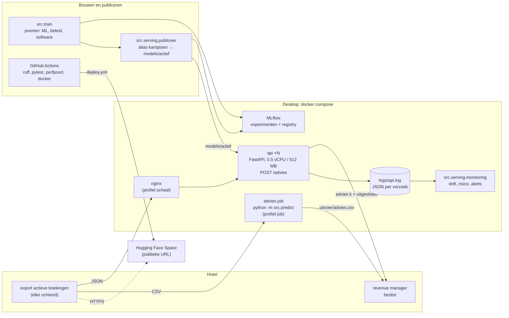

# Architectuur: een routekaart door de code

**In één alinea.** Er zijn twee aparte wegen. De *adviesweg* neemt de boekingen van één nacht
(als CSV of als API-verzoek), controleert ze, voorspelt per boeking de kans op annuleren, telt die
kansen op per hotel en geeft het advies k terug. De *trainingsweg* leert uit de historische
boekingen een model, en schrijft het alleen weg als het alle poorten haalt. Beide wegen gebruiken
dezelfde config (`configs/default.yaml`) en dezelfde regels voor geldige en toepasbare boekingen.

## De adviesweg: van boekingen naar advies

```text
CSV-bestand (src/predict.py)  of  API-verzoek (src/serving/api.py)
        |
        v
voer_job_uit()  in src/predict.py: de enige plek waar het advies berekend wordt
        |
        |-- 1. schema:  zijn de gegevens geldig?               src/schema.py + src/data.py
        |-- 2. scope:   mag dit model deze boekingen beoordelen? src/scope.py
        |-- 3. voorspellen: kans op annuleren per boeking      model.predict_proba
        |-- 4. aggregeren: kansen optellen per hotel-nacht     src/nachten.py (per_nacht)
        |-- 5. advies:  het grootste k met 80 % zekerheid      src/nachten.py (met_advies)
        '-- 6. het advies zelf valideren                       src/schema.py (ADVIES)
        |
        v
advies per hotel + de uitgesloten boekingen met hun reden  →  CSV of JSON
```

Elke stap is een fase in een `Meting` (`src/serving/meting.py`): zo is te zien waar de tijd naartoe gaat.
Omdat de opdrachtregel en de API allebei `voer_job_uit()` aanroepen, kunnen ze nooit een ander
advies geven (`tests/test_job.py`).

**Waar je iets verandert:**

| Je wilt ... | Bestand |
|---|---|
| een kolom of toegelaten waarde aanpassen | `src/schema.py` (de API volgt automatisch) |
| een uitsluitingsregel aanpassen | `src/scope.py`, de grenzen in `configs/default.yaml` |
| de zekerheid of de risicogrens aanpassen | `configs/default.yaml` (`advies`) |
| een veld in het API-antwoord toevoegen | `src/serving/api.py` |

## De trainingsweg: van historische data naar een model

```text
data/hotel_bookings.csv
    -> valideren en opschonen, label maken          src/data.py, src/schema.py, src/scope.py
    -> splitsen op aankomstdatum, met embargo        src/train.py (grenzen, splits), src/folds.py
    -> leren op de training, meten op de validatie   src/train.py, src/baseline.py, src/kenmerken.py
    -> ML- en beleidspoorten op de validatie         src/poorten.py
    -> opnieuw leren op de hertraining, test meten   src/train.py
    -> softwarepoorten (latency, modelgrootte)       src/poorten.py
    -> model + advies + manifest wegschrijven        src/train.py, src/serving/manifest.py
```

Alles in `train.bouw_en_bewaar()`. Faalt één poort, dan wordt er niets weggeschreven.

**Waarom niet `train_test_split`.** Het sjabloon van labo 5 splitst willekeurig, met `stratify`.
Hier zou dat de toekomst in de training laten lekken en exacte kopieën over de split verspreiden:
logreg haalt dan een AUC van 0,756, in de tijd 0,627. Daarom vier delen op aankomstdatum, met een
embargo: training (leren), validatie (kiezen, de poorten), hertraining (opnieuw leren tot vlak
vóór de test) en test (één keer meten, alleen rapporteren). Uitleg en cijfers:
[model.md](model.md#de-split-in-de-tijd-op-aankomstdatum).

## Waarom deze controles blijven

Ze lijken misschien overbodig, maar elk vangt een ander probleem:

| Controle | Wat het voorkomt |
|---|---|
| schema **én** scope | geldige gegevens zijn nog geen gegevens waarover dit model mag oordelen (een Non Refund-boeking is geldig, maar valt buiten het domein) |
| split op tijd, met embargo | dat toekomstige uitkomsten ongemerkt in de training lekken |
| manifest met hashes (`src/serving/manifest.py`) | dat een model, adviesinstellingen en config uit verschillende runs samen gebruikt worden |
| releasepoorten (`src/poorten.py`) | dat een model dat slechter is dan de vuistregel, te traag is of één hotel te veel risico geeft, gepubliceerd wordt |
| `src/kenmerken.py` als aparte module | een opgeslagen model verwijst naar de functies erin met hun modulepad; zouden ze verhuizen, dan laadt het model niet meer |
| twee routes achter één `per_nacht()` | voor één nacht (het advies) neemt `per_nacht()` zelf de zuinige route `_een_nacht`; over een periode (de evaluatie) rolt `_alle_nachten` elk verblijf uit. De uitvoer is dezelfde (getest), en E9 meet de twee routes naast elkaar |

## Alle bestanden, één zin elk

`src/` heeft drie delen: de kern van deel 2 rechtstreeks in `src/`, het onderzoek in
`src/onderzoek/` en deel 3 in `src/serving/`. `src/kenmerken.py` blijft op zijn plaats: een
opgeslagen model verwijst naar `src.kenmerken`.

```text
src/                   kern (deel 2): inlezen, controleren, trainen, evalueren, voorspellen
  config.py            leest de config
  data.py              inlezen, valideren met leesbare fouten, opschonen, label afleiden
  datums.py            de aankomstdatum uit drie kolommen, op één plek
  schema.py            hoe invoer, trainingsdata en advies eruitzien (Pandera), met de categorieën
  kenmerken.py         bewerkingen ín de pijplijn (stabiel modulepad, zie hierboven)
  baseline.py          de vuistregel van de revenue manager
  train.py             split, model bouwen, trainen, poorten, wegschrijven
  folds.py             het embargo van de split; train.py gebruikt dezelfde formule als rolling origin
  kansen.py            voorspel(): van model en boekingen naar kansen, voor trainen en voorspellen
  nachten.py           van kansen per boeking naar advies k per hotel-nacht, en de euro's
  evaluate.py          alle modellen naast elkaar, per hotel-nacht
  figuren.py           de grafieken van deel 2 en het onderzoek; evaluate.py tekent ermee
  predict.py           model laden, manifest controleren, voer_job_uit(), de opdrachtregel
  scope.py             het toepassingsdomein; data.schoon_op() en predict.py delen die grens
  logboek.py           logging naar het scherm en naar logs/<opdracht>.log, voor elke opdracht
  poorten.py           de releasepoorten: ML, beleid per hotel, software; train.py stopt erop
  api.py, publiceer.py ingangen voor het Dockerfile en deploy.yml (zie hieronder)

src/onderzoek/         onderzoek en verantwoording (extra, geen eis van deel 2)
  audit.py             filterwaterval, besliscontract A tegenover B, dekking per nacht
  experimenten.py      vergelijkingen, verliesrekening, segmenten, drempel, gevoeligheid
  robuustheid.py       risico per hotel en maand, blokbootstrap, rolling origin, complexiteit
  business.py          businessstress, ROI-raming, verband tussen MAE en euro's

src/serving/           serving en opereren (deel 3)
  api.py               POST /advies, POST /kansen, GET /health (FastAPI)
  figuren.py           de figuren van de softwaremetriek en de deployment
  manifest.py          model, advies, config en data aan één run binden
  meting.py            tijd per fase en geheugenpiek van een adviesjob
  monitoring.py        drift per verzoek, risico na de nacht, alarmen
  publiceer.py         MLflow-registry, alias kampioen, export naar models/actief/
  tracking.py          experimenten in MLflow, met verplichte beslisregel
  vrijgave.py          wat src.train voor deel 3 voorbereidt: softwarepoort en manifest
```

De kern gebruikt drie modules uit `src/serving/`: `train.py` roept `vrijgave` en `manifest` aan
(softwarepoort, manifest, driftreferentie), `predict.py` gebruikt `manifest` en `meting`. Dat
bereidt deel 3 voor; wie deel 2 leest, hoeft ze niet te openen. `src/api.py` en
`src/publiceer.py` zijn ingangen van twee regels: het Dockerfile (`uvicorn src.api:app`) en
`deploy.yml` (`python -m src.publiceer`) horen bij deel 3 en wijzen nog naar die namen.

De onderzoeksmodules gaan verder dan wat de opdracht van deel 2 vraagt ("een ML-oplossing in een
gestructureerde repo, met data-exploratie en minstens twee modellen"), en `InfoVak.txt` zegt dat
modellen kiezen, architecturen vergelijken en hyperparameters tunen niet het werk van dit vak is.
Ze staan er als verantwoording van de keuzes (bootstrap, rolling origin, complexiteitsladder,
kalibratie); om deel 2 te beoordelen zijn ze niet nodig. De kern is ongeveer 2 700 regels,
`src/onderzoek/` 2 600 en `src/serving/` 1 300.

### De rest van de repo

```text
configs/default.yaml   paden, horizon, opschoning, features, split, vuistregel, advies,
                       risicogrens, poorten, model. Geen code
configs/benchmark.yaml de softwaremetriek en haar grenzen, vastgelegd vóór de eerste meting
configs/experimenten/  hypothese en beslisregel per experiment, vastgelegd vóór het draaien
configs/README.md      welke config bij welk commando hoort

benchmarks/            workloads, de softwaremetriek, software-experimenten, foutgedrag,
                       containermetingen, loadtest, batchjob, kosten, replay, CI-poort
tests/                 één testbestand per onderwerp; test_systeem.py neemt de hele weg
data/                  hotel_bookings.csv (de export), nieuwe_boekingen.csv (voorbeeldinvoer)
notebooks/             01_exploratie.ipynb: de verkenning achter de keuzes
resultaten/            alle meetresultaten, gecommit: het bewijs achter de cijfers in de tekst
docs/                  de documentatie (zie de README voor wegwijzers)
rapport/               de rapporten van deel 2 en deel 3
Dockerfile, compose.yaml, infra/nginx.conf, .github/workflows/   de uitrol
models/, logs/         gemaakt door src.train en de opdrachten. Niet gecommit
```

## De uitrol in één beeld

Lokaal draait alles als compose-stack op de desktop; publiek draait hetzelfde API-image op een
Hugging Face Space. Details: [deployment.md](deployment.md). Keuze en afweging:
[adr/0001-waar-het-draait.md](adr/0001-waar-het-draait.md).



De softwaremetriek zelf is gemeten op 1 vCPU / 1 GiB (`configs/benchmark.yaml`); compose begrenst
de API lokaal op 0,5 vCPU / 512 MB, de kleinste combinatie die de grens haalt.

## Onderdelen

| Onderdeel | Code | Draait als | Bewijs |
|---|---|---|---|
| Advies (kern) | `voer_job_uit()` in `src/predict.py` | gedeeld door API en batch | `tests/test_job.py` |
| API | `src/serving/api.py` | `uvicorn`, in het image (`Dockerfile`) | `tests/test_api.py`, `foutgedrag.csv` |
| Batchjob | `src/predict.py` | `docker compose --profile job run --rm advies-job <csv> --nacht ... --as-of ... --uitvoer uitvoer/advies.csv` | `resultaten/serving/batchjob.csv` |
| Schalen | `infra/nginx.conf` | `docker compose --profile schaal up -d --scale api=4` | `resultaten/serving/belasting.csv` |
| Experimenten en registry | `src/serving/tracking.py`, `src/serving/publiceer.py` | MLflow (sqlite lokaal, of de compose-service) | `resultaten/runs.csv` |
| Releasepoorten | `src/poorten.py` | in `src.train`, vóór het wegschrijven | `models/manifest.json`, `tests/test_poorten.py` |
| Monitoring | `src/serving/monitoring.py` | na de dagelijkse batch: `python -m src.serving.monitoring controleer` | `tests/test_monitoring.py`, `resultaten/monitoring/` |
| CI en deploy | `.github/workflows/ci.yml`, `docker.yml`, `deploy.yml` | GitHub Actions | — |

## Planning op Windows (niet automatisch ingesteld)

De dagelijkse batch en de controle kunnen met de Windows-taakplanner. Dit commando maakt zo'n taak
aan; het is bewust niet uitgevoerd, omdat het een blijvende instelling op de machine wijzigt:

```powershell
schtasks /Create /TN "Overboeking advies" /SC DAILY /ST 06:00 /TR "cmd /c cd /d C:\pad\naar\cloud-for-ai-project && docker compose --profile job run --rm advies-job invoer/vandaag.csv --uitvoer uitvoer/advies.csv && .venv\Scripts\python.exe -m src.serving.monitoring controleer"
```
