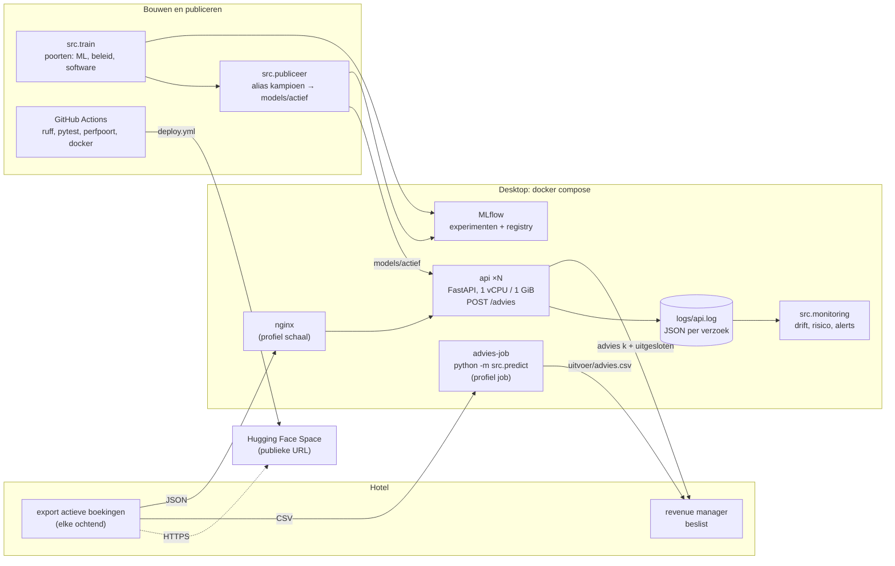

# Architectuur

Lokaal draait alles als docker-compose-stack op de desktop; publiek draait hetzelfde API-image op
een Hugging Face Space. Keuze en afweging: [adr/0001-waar-het-draait.md](adr/0001-waar-het-draait.md).



## Onderdelen

| Onderdeel | Code | Draait als | Bewijs |
|---|---|---|---|
| Advies (kern) | `voer_job_uit()` in `src/predict.py` | gedeeld door API en batch | `tests/test_job.py` |
| API | `src/api.py` | `uvicorn`, in het image (`Dockerfile`) | `tests/test_api.py`, `foutgedrag.csv` |
| Batchjob | `src/predict.py` | `docker compose --profile job run --rm advies-job <csv> --nacht ... --as-of ... --uitvoer uitvoer/advies.csv` | `resultaten/serving/batchjob.csv` |
| Schalen | `infra/nginx.conf` | `docker compose --profile schaal up -d --scale api=4` | `resultaten/serving/belasting.csv` |
| Experimenten en registry | `src/tracking.py`, `src/publiceer.py` | MLflow (sqlite lokaal, of de compose-service) | `resultaten/runs.csv` |
| Releasepoorten | `src/poorten.py` | in `src.train`, vóór het wegschrijven | `models/manifest.json`, `tests/test_poorten.py` |
| Monitoring | `src/monitoring.py` | na de dagelijkse batch: `python -m src.monitoring controleer` | `tests/test_monitoring.py`, `resultaten/monitoring/` |
| CI en deploy | `.github/workflows/ci.yml`, `deploy.yml` | GitHub Actions | — |

## Planning op Windows (niet automatisch ingesteld)

De dagelijkse batch en de controle kunnen met de Windows-taakplanner. Dit commando maakt zo'n taak
aan; het is bewust niet uitgevoerd, omdat het een blijvende instelling op de machine wijzigt:

```powershell
schtasks /Create /TN "Overboeking advies" /SC DAILY /ST 06:00 /TR "cmd /c cd /d C:\pad\naar\cloud-for-ai-project && docker compose --profile job run --rm advies-job invoer/vandaag.csv --uitvoer uitvoer/advies.csv && .venv\Scripts\python.exe -m src.monitoring controleer"
```
