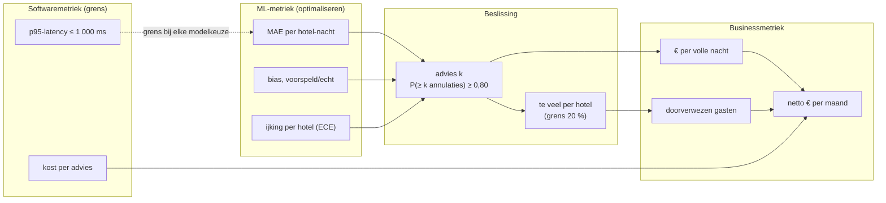

# De drie metrieken en hoe ze samenhangen

Les 03: één ML-metriek, één softwaremetriek, één businessmetriek, elk verantwoord. Les 06 p. 23:
één optimaliseer je, de andere is een grens. Dit document zet ze samen en toont de vertaalslag.

## Definities

| Metriek | Soort | Definitie | Eenheid | Richting | Rol | Grens | Bron |
|---|---|---|---|---|---|---|---|
| MAE per hotel-nacht | ML | gemiddelde \|Σ kansen − echte annulaties\| per hotel-nacht | annulaties | lager | **optimaliseren** | < vuistregel (poort) | `evaluatie.csv`, `beoordeel()` |
| bias, voorspeld/echt | ML | gemiddelde (verwacht − echt); Σ verwacht / Σ echt | annulaties; verhouding | dicht bij 0; bij 1 | diagnose | voorspeld/echt per hotel tussen 0,8 en 1,25 (poort) | `evaluatie.csv` |
| AUC, Brier, ECE | ML, per boeking | rangschikking, kansfout, ijking per hotel | — | hoger; lager; lager | diagnose | AUC ≥ 0,60 (poort) | `evaluatie.csv`, `kalibratie.csv` |
| te veel | beleid | aandeel nachten met minder annulaties dan k | % | lager | **grens** | ≤ 20 % per hotel (poort op de validatie) | `evaluatie.csv` |
| te veel op volle nachten (`te_veel_vol`) | beleid | idem, alleen nachten die volgeboekt waren | % | lager | diagnose | — | `evaluatie.csv` |
| te veel als er overboekt wordt (`te_veel_k_pos`) | beleid | idem, alleen nachten met k > 0 | % | lager | diagnose | — | `evaluatie.csv` |
| tekort | beleid | max(k − echt, 0): kamers te veel, gemiddeld, p95, max | kamers | lager | diagnose | — | `evaluatie.csv` |
| € per volle nacht | business | europroxy: r × adr per gevulde extra kamer − w × adr per doorverwezen gast | € | hoger | **businessmetriek** | — | `evaluatie.csv` |
| doorverwezen | business | gasten doorverwezen per volle nacht | gasten | lager | guardrail | — | `evaluatie.csv` |
| netto € per maand | business | bruto − infrastructuur − beheer, onder scenario's | € | hoger | raming | — | `business/roi.csv` |
| p95-latency | software | `POST /advies`, normale portefeuille, warm, 1 vCPU / 1 GiB | ms | lager | **grens** | ≤ 1 000 ms (poort en CI) | `software/summary.csv` |
| koude start | software | container start → eerste antwoord | s | lager | grens | ≤ 60 s | `serving/` |
| kost per advies | software | CPU-seconden × prijs | € / 1 000 adviezen | lager | gerapporteerd | — | `serving/kosten.csv` |

## De vertaalslag, gemeten

- **ML → business:** over 38 varianten uit de experimenten Spearman ρ = −0,72 (p < 0,001) tussen
  MAE en € per volle nacht. De hypothese uit deel 1 ("lagere fout, meer winst") houdt stand
  (`metriekverband.csv`, `resultaten/figuren/mae_vs_euro.png`).
- **ML → risico:** geen aantoonbaar verband tussen \|bias\| en te veel (ρ = 0,21, p = 0,29). Het
  risico hangt vooral af van het seizoen en het hotel, niet van één getal van het model
  ([verantwoording.md](verantwoording.md), sectie 13).
- **Software als grens:** de grens bindt op deze infrastructuur bij geen enkel model uit de
  complexiteitsladder (hoogste p95 138 ms); ze kost geen MAE. Ze staat wel als poort in
  `src/train.py` en in CI, zodat een trager model of een tragere implementatie niet ongemerkt
  wordt gepubliceerd.
- **Business onder aannames:** de meerwaarde tegenover de vuistregel hangt af van hoe vol de nacht
  op het beslismoment is ([business_roi.md](business_roi.md)).
