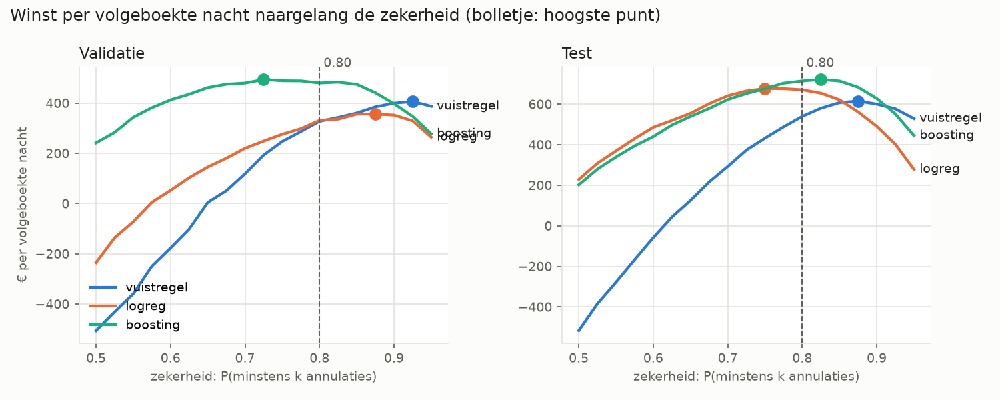
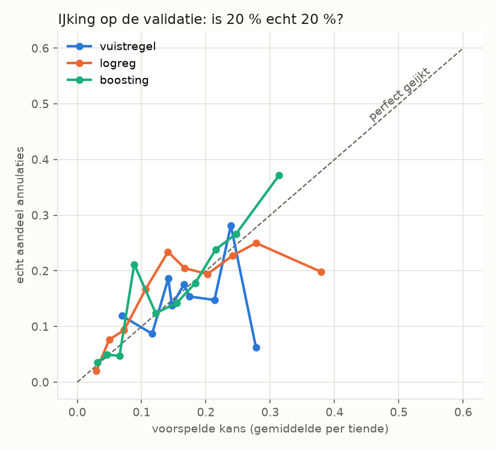

# Het model: data, split, modellen, evaluatie en bevindingen

De inhoudelijke uitleg van het model, voor wie wil weten *waarom* het zo werkt. Om het project
te draaien heb je dit niet nodig: zie de [README](../README.md). Elke keuze met haar opties en
cijfers staat in [verantwoording.md](verantwoording.md); dit document is de doorlopende uitleg.

De cijfers hieronder komen uit `resultaten/` en worden gecontroleerd door
`tests/test_bewijsregister.py`: verandert een resultaat, dan faalt die test tot de tekst klopt.

## Data

`data/hotel_bookings.csv` is *Hotel booking demand* van Kaggle
(kaggle.com/datasets/jessemostipak/hotel-booking-demand): 119 390 boekingen van een
stadshotel in Lissabon en een resort in de Algarve, met aankomst tussen juli 2015 en augustus
2017.

Bron: Antonio, N., de Almeida, A. & Nunes, L. (2019). Hotel booking demand datasets.
*Data in Brief, 22*, 41–49. https://doi.org/10.1016/j.dib.2018.11.126. Licentie CC BY 4.0.

Er staan geen namen of contactgegevens in. `country` gebruikt het model niet: de kolom is
waarschijnlijk pas na het beslismoment ingevuld (zie [Bevindingen](#bevindingen)).

`data/nieuwe_boekingen.csv` is geldige voorbeeldinvoer om te voorspellen: de 76 boekingen die
op 16 juli 2017 nog actief waren en op 15 augustus 2017 aankomen, zonder hun afloop. Gasten die
eerder aankwamen en die nacht nog blijven, zitten er niet in. In productie zou de export van het
beslismoment alle actieve boekingen van die nacht bevatten.

### Exploratie

`notebooks/01_exploratie.ipynb` verantwoordt de keuzes in `src/`: wat er in de data zit, wat er
stuk aan is en wat eraan gedaan is, Non Refund, het label, een lekcontrole per kolom, het land,
de capaciteit, waarom annulaties per nacht breder spreiden dan losse annulaties, of segment en
agent het land doorgeven, en of `adr` bij een annulatie achteraf aangepast is. Het notebook
verandert zelf niets aan de data: alles gebeurt in de code, zodat training en voorspellen
dezelfde stappen doorlopen. Enkele vaststellingen:

- **Dubbele rijen.** 27 % van de rijen is een exacte kopie van een andere. Zonder boekingsnummer
  is dat niet te onderscheiden van een tweede kamer in dezelfde groep. Ze blijven staan, en ze
  kunnen niet over de split lekken: kopieën hebben dezelfde aankomstdatum.
- **Non Refund.** 99,4 % staat als geannuleerd, 97 % is Portugees, 97 % zijn groepen of
  touroperators, en maar 93 van de 14 587 checkten uit. Dat is geen gedrag maar een
  eigenaardigheid van de export. Ze gaan eruit.
- **Kolommen die pas bij aankomst ingevuld worden.** Een parkeerplaats, een andere kamer dan
  gereserveerd, wijzigingen en speciale wensen. Van de 3 265 actieve boekingen met een
  parkeerplaats annuleert er niet één. Geen van die kolommen is een feature.
- **Annulaties komen samen.** 22 % van de late annulaties valt samen met minstens vier
  identieke boekingen, met groepen tot 60. Daarom de spreidingsfactor.
- **`adr` lekt niet.** Een geannuleerde boeking houdt haar geboekte tarief: het staat niet op 0
  (0,4 % tegenover 2,3 % bij wie uitcheckte), en de verdeling per hotel, segment en maand is
  dezelfde. Alleen ronde bedragen komen bij annulaties vaker voor (48 tegenover 42 %), en daar
  haalt het model niets uit. `adr` blijft een feature. Zie bevinding 6.

## Van ruwe export naar trainingsset

1. **Valideren** (`src/schema.py`): de csv moet aan het schema voldoen, anders stopt alles.
2. **Opschonen** (`schoon_op()` in `src/data.py`): de boekingen buiten scope gaan eruit. Dat zijn
   `Non Refund`, een `adr` van 0 of minder of van 1 000 of meer, en verblijven van nul nachten.
3. **Label** (`maak_label()`): alleen boekingen die 30 dagen vóór aankomst nog actief zijn.
   Label 1 als ze daarna alsnog geannuleerd worden of een no-show worden. Er blijven
   50 824 boekingen over, met een basiskans van 14,3 %.

De horizon en de opschoningsgrenzen staan in `configs/default.yaml`.

Bewust geen feature, omdat ze pas na het beslismoment gekend zijn of dat vermoedelijk zijn:
`reservation_status(_date)` (het label), `assigned_room_type`, `booking_changes`,
`required_car_parking_spaces`, `total_of_special_requests`, `days_in_waiting_list` en
`country`. De lekcontrole per kolom staat in het notebook, het register per kolom (wanneer
gekend, kan het later veranderen, wat is beslist) in
[docs/feature_beschikbaarheid.csv](feature_beschikbaarheid.csv), en wanneer een label
gekend is in [docs/label_beschikbaarheid.md](label_beschikbaarheid.md).

Hoeveel boekingen elk filter weghaalt, per hotel en jaar: `resultaten/audit/filterwaterval.csv`.

### Het schema

Twee schema's: `INVOER` (een boeking zoals het boekingssysteem ze exporteert) en `TRAINING`
(dezelfde export plus de eindstatus). Per kolom ligt het type vast, net als het bereik, de
toegelaten waarden en of ze leeg mag zijn. `TRAINING` controleert ook de dataset als geheel:
de mediaan van `adr`, de mediaan van `lead_time`, en het aandeel annulaties en no-shows. Dat
aandeel moet tussen 20 en 50 % liggen; in de export is het 37 %.

Wat het schema tegenhoudt, en wat niet:

| Fout | Gestopt? | Door welke controle |
|---|---|---|
| kolom hernoemd (`adr` → `adr_eur`) | ja | de kolom ontbreekt |
| `adr` in cent | ja | `adr < 10 000` per rij, en de mediaan |
| `lead_time` in uren | ja | `lead_time` tussen 0 en 3 jaar, en de mediaan |
| `lead_time` in weken | alleen bij training | de mediaan. Per rij blijft alles binnen het bereik |
| iedereen op `Canceled` | ja | het aandeel annulaties. Per rij is elke status geldig |
| alleen wie uitcheckte, of de meeste annulaties eruit gefilterd | ja | het aandeel annulaties |
| `adr` in dollar | nee | ligt te dicht bij de euro voor een vast bereik |
| `adr` per verblijf in plaats van per nacht | nee | blijft binnen bereik en mediaan |

Wat ontbreekt voor de laatste twee: een vergelijking van de verdeling met die van de
trainingsdata, in plaats van een vaste grens. Dat is driftbewaking, voor deel 3. Bij
voorspellen controleert het schema alleen per rij: één boeking heeft geen mediaan.

Zonder schema geeft een export in centen stil onzin: het voorbeeldbestand krijgt dan 0,0 %
kans op annuleren, en het hotel zou nooit overboeken.

## De split: in de tijd, op aankomstdatum

| Deel | Aankomst | Boekingen | Annuleert | Waarvoor |
|---|---|---|---|---|
| training | 01-07-2015 tot 30-11-2016 | 31 840 | 14,9 % | het model leren |
| validatie | 01-01-2017 tot 31-03-2017 | 4 439 | 16,6 % | het model kiezen, de poorten, de spreidingsfactor |
| hertraining | 01-07-2015 tot 28-02-2017 | 35 629 | 15,5 % | het gekozen model opnieuw leren |
| test | 01-04-2017 tot 31-08-2017 | 13 064 | 11,5 % | één keer meten, alleen rapporteren |

Een willekeurige split laat de toekomst in de training lekken: een boeking van augustus 2017
helpt dan een boeking van januari 2017 voorspellen. Daarom wordt op aankomstdatum gesplitst.
Met een willekeurige split haalt de logistische regressie een AUC van 0,756, met de split in de
tijd 0,627 (boosting: 0,797 tegenover 0,695, `resultaten/audit/split.csv`). Het verschil wijst
op optimisme door de tijd te mengen, en deels op exacte kopieën die over de split vallen. Met
de kopieën samen aan één kant zakt de willekeurige AUC naar 0,735 (logreg) en 0,759 (boosting):
kopieën verklaren 16 % en 37 % van het verschil (`resultaten/audit/split_duplicaten.csv`). De
twee splits meten ook niet op dezelfde boekingen, dus het hele verschil is niet zomaar lek.

Tussen training en validatie zit een **embargo**. Op 2 december beslis je voor 1 januari. De
afloop van boekingen met aankomst in december ken je dan nog niet, dus die mogen niet in de
training. Een no-show ken je pas de dag na aankomst, vandaar nog een dag extra. De training
stopt dus op 30 november. Hetzelfde geldt voor de hertraining vóór de test: die stopt op
28 februari. De datums staan in `configs/default.yaml`, het embargo rekent `grenzen()` in
`src/train.py` uit. `tests/test_split.py` controleert het met de aankomstdatums zelf.

Het model wordt gekozen en tegengehouden op de validatie. Daarna wordt het opnieuw getraind
op de hertraining, omdat het hotel in de praktijk ook de recentste data zou gebruiken, en één
keer op de test gemeten. Op de test wordt niets gekozen.

## De modellen

| `model.soort` | Wat |
|---|---|
| `vuistregel` | de baseline, wat de revenue manager vandaag doet (`src/baseline.py`) |
| `logreg` | logistische regressie: lege waarden invullen, schalen, one-hot-encoderen |
| `boosting` | `HistGradientBoostingClassifier`, met de categorieën als categorieën, 100 iteraties. Zonder vroege stop, want die zet een willekeurig stuk van de training apart |

De **vuistregel** neemt het annulatiepercentage van het afgelopen jaar, per hotel ×
`market_segment` × klasse van `lead_time` (<60, 60–120, 120–240, 240+ dagen). Een groep met
minder dan 30 boekingen krijgt het percentage van het hotel. Ze gebruikt alle historiek
(`venster_maanden: null`): op de validatie is dat de sterkere baseline (MAE 6,36 tegenover 6,65
met de laatste 12 maanden). Een sterkere baseline maakt de poort strenger.

Alles wat iets leert uit de data zit ín de pijplijn, ook het groeperen van het land
(`land_als_groep` in `src/kenmerken.py`). Ruwe rijen uit het boekingssysteem gaan er dus
rechtstreeks in.

### Wisselen van model

Eén sleutel in `configs/default.yaml`, en daarna opnieuw trainen:

```yaml
model:
  soort: boosting      # vuistregel | logreg | boosting
features:
  gebruik_land: false  # true: het land als PRT tegenover de rest
```

```bash
python -m src.train
```

`src.train` traint wat in de config staat, en schrijft het alleen weg als het door de poorten
komt. `soort: vuistregel` komt er dus nooit door: ze kan zichzelf niet verslaan. Om alle
modellen te vergelijken, hoef je de config niet aan te passen: `python -m src.evaluate`
draait ze allemaal, met en zonder land.

## Evaluatie per hotel-nacht

### Van kansen naar een advies

1. **Per nacht tellen.** Een boeking telt mee in elke nacht van haar verblijf. Per hotel-nacht
   is het verwachte aantal annulaties de som van de kansen, en de variantie de som van
   p × (1 − p). Het label blijft verankerd op de aankomst: dat is een vereenvoudiging, gemeten in
   [docs/besliscontract.md](besliscontract.md). De eerste nachten van een periode delen hun
   portefeuille met gasten die vóór de periode aankwamen; een nacht telt pas mee als minstens
   95 % van haar boeking-nachten in de periode zit (`evaluatie.min_dekking`). Zo vallen er 16 van
   de 180 nachten op de validatie weg en 11 van de 306 op de test.
2. **Spreidingsfactor.** Boekingen annuleren niet los van elkaar, want een groep annuleert
   samen. De spreiding wordt daarom vermenigvuldigd met een factor per hotel en per model,
   geschat op de validatie: de wortel uit het gemiddelde van (echt − verwacht)² / variantie,
   met een minimum van 1. Voor boosting is dat 2,5 voor City en 1,5 voor Resort.
3. **Advies k.** Het grootste aantal waarvoor P(minstens k annulaties) ≥ 0,80, met een
   normale benadering. Er is geen maximum per nacht (`advies.max_aandeel: null`); de
   bescherming voor de gast is de zekerheid zelf. De risicogrens van 20 % begrenst het advies
   niet tijdens het voorspellen: ze is het criterium waarmee de zekerheid op de validatie
   gekozen is (`drempel()` in `src/experimenten.py`), en wordt na de evaluatie gemeten.
4. **Capaciteit.** De dataset zegt niet hoeveel kamers er zijn. Daarom het 99ste percentiel
   van de bezette kamers per nacht in de training, uit alle uitgecheckte boekingen. City komt
   op 226 kamers, Resort op 184. Een nacht telt als volgeboekt vanaf 95 % van de capaciteit.
5. **Bedragen.** Elke kamer die echt vrijkomt en die je extra verkocht, levert r × adr op.
   Elke gast te veel kost W × adr: die moet je doorverwijzen naar een ander hotel. Met r = 0,5
   en W = 2 loont de k-de kamer zolang P(minstens k) ≥ W / (r + W) = 0,80. Daar komt de
   drempel vandaan. Dit is een **europroxy**: ze klopt als de nacht op het beslismoment precies
   volgeboekt is en elke extra kamer verkocht wordt. Zie
   [docs/business_aannames.md](business_aannames.md).

Dezelfde functie (`met_advies()` in `src/nachten.py`) geeft het advies in de evaluatie en in
`src.predict`. Wat geëvalueerd wordt, is dus wat het hotel te zien krijgt.

### Resultaten

`python -m src.evaluate` schrijft alles naar `resultaten/`: `evaluatie.csv` (per model en per
hotel, met de gevoeligheid voor r = 0,3 en W = 3), `groepen.csv`, `winstcurve.csv`,
`winstcurve.png` en `ijking.png`. `python -m src.experimenten` voegt in `resultaten/audit/` de
vergelijkingen, de foutenanalyse en de gevoeligheid toe. Hieronder beide hotels samen.

Validatie (Q1 2017, 164 hotel-nachten, waarvan 30 volgeboekt). Hier wordt gekozen. "Te veel":
aandeel nachten met minder annulaties dan k; de risicogrens is 20 %.

| Model | MAE | voorspeld/echt | € per volgeboekte nacht | doorverwezen per volle nacht | te veel |
|---|---|---|---|---|---|
| vuistregel | 6,36 | 1,11 | 328 | 2,23 | **23 %** |
| logreg zonder land | 5,77 | 0,98 | 331 | 1,43 | 13 % |
| **boosting zonder land** | **4,72** | 0,90 | **480** | 0,43 | 11 % |
| logreg met land | 4,95 | 0,82 | 502 | 0,03 | 2 % |
| boosting met land | 4,58 | 0,82 | 484 | 0,00 | 2 % |

Test (april tot augustus 2017, 295 hotel-nachten, waarvan 199 volgeboekt, na hertrainen). Alleen
gerapporteerd:

| Model | MAE | voorspeld/echt | € per volgeboekte nacht | doorverwezen per volle nacht | te veel |
|---|---|---|---|---|---|
| vuistregel | 6,87 | 1,31 | 540 | 1,76 | **31 %** |
| logreg zonder land | 5,35 | 1,04 | 671 | 0,32 | 9 % |
| **boosting zonder land** | **5,11** | 1,07 | **715** | 0,54 | 16 % |
| logreg met land | 5,12 | 0,87 | 582 | 0,04 | 2 % |
| boosting met land | 5,39 | 1,01 | 700 | 0,23 | 9 % |

"Te veel" is hier over beide hotels samen. Per hotel, voor boosting zonder land
(`resultaten/evaluatie.csv`): City 6 % op de validatie en **22 % op de test**, Resort 16 % en
10 %. Op de test gaat City dus over de risicogrens. Dat is gemeten, niet achteraf weggewerkt: de
test kiest niets.

**Gekozen: boosting zonder land**, op de laagste MAE op de validatie van de modellen zonder land.
Het is ook op de test het beste model zonder land. De modellen met land staan er ter
vergelijking: waarom ze niet in aanmerking komen, staat in bevinding 1. Eerst had boosting 200
iteraties (validatie 4,87). De AUC op de training lag veel hoger dan op de validatie (0,85
tegenover 0,69); 100 iteraties is op de validatie aantoonbaar beter en is overgenomen. Eén ronde,
geen zoektocht: zie de bewijskaart "Hyperparameters" in
[docs/verantwoording.md](verantwoording.md).

| AUC | validatie | test |
|---|---|---|
| vuistregel | 0,557 | 0,613 |
| logreg zonder land | 0,627 | 0,626 |
| boosting zonder land | 0,695 | 0,647 |

### De poorten vóór het wegschrijven

`python -m src.train` schrijft het model alleen weg als het **alle** poorten haalt, allemaal op de
validatie (nooit op de test). Ze staan in `src/poorten.py`; de grenzen in `configs/default.yaml`
en `configs/benchmark.yaml`.

| Soort | Poort | Waarom | Boosting |
|---|---|---|---|
| ML | lagere MAE per hotel-nacht dan de vuistregel | anders heeft het model geen reden om te bestaan | 4,72 tegenover 6,36 |
| ML | AUC minstens 0,60 (`minimum_auc`) | daaronder rangschikt het model nauwelijks beter dan toeval | 0,695 |
| ML | per hotel voorspeld/echt tussen 0,8 en 1,25 (`poorten.ijking_per_hotel`) | een som van kansen moet geijkt zijn, per hotel | |
| beleid | per hotel hoogstens 20 % nachten met minder annulaties dan k (`advies.risicogrens`) | een gepoold gemiddelde kan één hotel verbergen | |
| software | p95-latency van de kern voor één nacht binnen 1 000 ms | de softwaremetriek is een grens | |
| software | modelbestand hoogstens 50 MB (`poorten.max_model_mb`) | het image en het laden blijven klein | |

Elke poort wordt gemeten en gelogd, ook als een eerdere al faalt: in de log en het manifest staat
waarom een model niet weggeschreven werd. Haalt het ze allemaal, dan wordt het opnieuw getraind op
de hertraining, één keer op de test gemeten, en weggeschreven. Naast `models/model.joblib` komt
`models/advies.json`: de spreidingsfactor per hotel (van de validatie) en de capaciteit per hotel
(van de training). Die heeft `src.predict` nodig voor k. `tests/test_poorten.py` test de poorten,
`tests/test_systeem.py` controleert dat een model dat ze niet haalt niets achterlaat.

### Het manifest

Naast model en advies schrijft `src.train` `models/manifest.json`: run, commit, sha256 van de
data, een hash van de config, de features, de trainperiode, de zekerheid, de versies van de
bibliotheken en de sha256 van model en advies (`src/manifest.py`). `src.predict` stopt met een
duidelijke melding als het model- of adviesbestand niet van die run is, of als de config sinds het
trainen anders beslist (features, label, split, advies of model). Een andere winstcurve of
gevoeligheidsanalyse mag wel. Getest in `tests/test_systeem.py`, ook met een bewust verwisseld
advies.

## Bevindingen

### 1. Het land is waarschijnlijk een lek. Daarom staat het uit

In het voorstel stond het land als feature, gegroepeerd tot PRT tegenover de rest. Het doet
de AUC met 0,08 stijgen (boosting 0,695 → 0,777), en in de lekcontrole is het de sterkste
kolom na het label zelf. Dat is te mooi om het zonder controle te geloven. Als het land pas bij
het inchecken ingevuld wordt, en anders op Portugal blijft staan, dan vertelt het niet waar de
gast vandaan komt, maar of hij is komen opdagen. Dat is het label zelf.

Wat de data zegt, voor de boekingen die actief zijn op het beslismoment:

| | aandeel PRT |
|---|---|
| uitgecheckt | 18 % |
| geannuleerd na het beslismoment | 52 % |
| no-show | 63 % |

- Een no-show is nooit aangekomen, en is toch voor 63 % Portugees.
- Van de geannuleerde groepsboekingen is 99 % Portugees, van de uitgecheckte 26 %.
  Groepsboekingen van buiten Portugal annuleren 0,2 % van de tijd.
- Hetzelfde patroon bij Offline TA/TO (89 % tegenover 20 %) en Corporate (94 % tegenover
  52 %). Bij Online TA, waar de gast zelf boekt, is het veel zwakker (29 % tegenover 12 %).
- 14 176 van de 14 587 Non Refund-boekingen zijn Portugees, en 99,4 % daarvan is geannuleerd.
  Dat past bij hetzelfde mechanisme.

Dat is geen bewijs, want het boekingssysteem zelf kan je niet bevragen. Maar alle signalen
wijzen dezelfde kant op, en een lek kost meer dan een feature die je mist. Daarom staat
`gebruik_land` op `false`. Met `true` kan je het model met land nog altijd vergelijken.

Op de MAE per hotel-nacht helpt het land trouwens weinig: op de validatie 4,58 tegenover 4,72,
op de test zelfs slechter (5,39 tegenover 5,11).

### 2. De controle per groep (PRT tegenover de rest) is zelf aangetast

Voorspeld/echt aantal annulaties per groep:

| Model | PRT validatie | rest validatie | PRT test | rest test |
|---|---|---|---|---|
| vuistregel | 0,53 | 1,31 | 0,45 | 1,86 |
| boosting zonder land | 0,37 | 1,13 | 0,32 | 1,58 |
| boosting met land | 0,85 | 0,76 | 0,71 | 1,25 |

Zonder land onderschat elk model de Portugese boekingen sterk en overschat het de rest. Als
bevinding 1 klopt, is dat geen eerlijkheidsprobleem van het model, maar van de groepsindeling:
"Portugees" betekent dan deels "is niet komen opdagen". Een eerlijke controle per groep
vraagt een land dat bij het boeken gekend is. Die kolom bestaat niet in deze export.

**Kijkt het model via een omweg toch naar het land?** Segment en agent hangen samen met het land.
Bij wie uitcheckte, is 12 % van Online TA Portugees en 52 % van Corporate, en uit segment of agent
alleen raad je PRT met een AUC van ongeveer 0,70 (notebook, sectie 9). Het land weglaten maakt
het model dus niet blind voor het land. Toch volgt het model het land niet: het geeft een
Portugese boeking op de validatie gemiddeld 12,2 % kans, de rest 15,2 %, terwijl de Portugese
boekingen 32,7 % annuleren en de rest 13,4 %. De onderschatting van PRT komt dus niet van een
omweg via segment of agent, maar van de groep zelf. Binnen één agent zie je dat het scherpst:
bij agent 28 is 7 % van wie uitcheckte Portugees, en 100 % van wie annuleerde. Dat steunt ook
bevinding 1. Voor een eerlijke controle later volstaat het land weglaten niet: die moet ook
nagaan wat segment en agent per land doen.

### 3. Het maximum verborg wat het model waard is. Het is weggehaald

In deel 1 mocht het hotel nooit meer dan 5 % van de capaciteit overboeken. Met dat maximum
haalden alle modellen ongeveer hetzelfde: op de test 638 € per volgeboekte nacht voor de
vuistregel, 633 € voor boosting. Dat kwam niet door het model. In City raakte het advies op 98 %
van de testnachten het maximum van 11 kamers, voor elk model. Dan beslist het maximum, niet het
model.

Dezelfde beslisregel, met en zonder maximum, en met en zonder spreidingsfactor
(`resultaten/audit/zonder_rem.csv`):

| € per volle nacht | validatie | test | te veel (test) | doorverwezen per volle nacht, test |
|---|---|---|---|---|
| vuistregel, max 5 % | 352 | 638 | 5 % | 0,10 |
| boosting, max 5 % | 357 | 633 | 5 % | 0,09 |
| vuistregel, geen maximum | 328 | 540 | **31 %** | 1,76 |
| logreg, geen maximum | 331 | 671 | 9 % | 0,32 |
| **boosting, geen maximum** | **480** | **715** | 16 % | 0,54 |
| boosting, geen maximum, geen spreidingsfactor | 466 | 518 | **33 %** | 1,88 |

- **Zonder maximum is boosting duidelijk het beste**, ook in euro's: +152 € per volle nacht
  tegenover de vuistregel op de validatie, +175 € op de test. Het betere voorspellen vertaalt zich
  in geld zodra het niet afgetopt wordt.
- **De vuistregel kan niet zonder maximum.** Ze overschat het aantal annulaties en adviseert op
  31 % van de testnachten te veel kamers, boven de risicogrens van 20 %. Het maximum verborg die
  fout.
- **De spreidingsfactor remt niet, ze beschermt.** Zonder factor zakt boosting op de test van 715
  naar 518 € en gaat het over de risicogrens. Ook binnen de validatie (afstemmen op januari en
  februari, meten op maart) blijft het zonder factor niet binnen de grens (36 %), met factor wel
  (19 %).

**Daarom is het maximum weggehaald** (`advies.max_aandeel: null`) en is het model opnieuw
getraind. Het advies wordt nu begrensd door de zekerheid van 0,80, niet door een vast aantal
kamers. De risicogrens is het criterium waartegen die zekerheid op de validatie gekozen is; ze
grijpt niet in bij het voorspellen. De prijs: op de test worden 0,54 gasten per volle nacht
doorverwezen in plaats van 0,09, in City 0,86. Dat zit in de europroxy (W = 2 × adr per gast).
Gepoold blijft het binnen de risicogrens (16 %), maar City alleen gaat er op de test over
(22 %). Wil het hotel toch een maximum, dan volstaat `max_aandeel` in de config;
`resultaten/audit/maximum.csv` toont wat 5, 7,5 en 10 % kosten.

### 4. De winstcurve: 0,80 blijft, ook zonder maximum



| Model | top validatie | top test |
|---|---|---|
| vuistregel | 0,925 | 0,875 |
| logreg | 0,875 | 0,75 |
| boosting | 0,725 | 0,825 |

Zonder maximum is de curve van boosting niet meer vlak: onder 0,70 gaat het advies op de
validatie over de risicogrens (meer dan 20 % van de nachten te veel) en zakt de winst snel. Boven
0,85 zakt ze ook. De zekerheid volgt uit de bedragen (W / (r + W) = 0,80), en wordt alleen
vervangen als een andere op de validatie binnen de risicogrens blijft én aantoonbaar meer
oplevert. 0,725 haalt 13,9 € meer per volle nacht, met een 90 %-bootstrapinterval van −34,9 tot
+56,6 €: niet aantoonbaar. 0,80 blijft (`resultaten/audit/drempel.csv`). Het punt wordt niet op
de test gekozen.

### 5. IJking: ruwweg juist, met ruis



Elk punt is een tiende van de validatie, ongeveer 440 boekingen. Logreg en boosting volgen de
diagonaal ruwweg tussen 5 en 30 %, met uitschieters. Logreg is bovenaan te zeker: in de
hoogste tiende voorspelt het 37 % en annuleert 20 %. De vuistregel heeft maar een handvol
verschillende kansen en volgt de diagonaal het slechtst. In totaal onderschat boosting het
aantal annulaties per nacht op de validatie met 10 % en overschat het op de test met 7 %. Dat
de fout van teken wisselt tussen winter en zomer, wijst eerder op het seizoen dan op de
ijking. Per maand is dat duidelijk: in City −8,3 annulaties per nacht in januari, +6,4 in juni
(`resultaten/audit/segment_nacht.csv`). Een korter trainingsvenster (12 maanden), herijken per
hotel en elke maand hertrainen zijn getest en afgewezen (`experimenten.csv`, `spreiding.csv`,
`hertraining.csv`). Elke maand hertrainen maakt de bias kleiner, maar de MAE op de validatie
aantoonbaar groter: 5,04 tegenover 4,72 (interval van het verschil +0,09 tot +0,59).

### 6. `adr` is het geboekte tarief, ook bij een annulatie

`adr` is volgens de bron de som van de verblijfstransacties gedeeld door het aantal nachten. Bij
wie uitcheckte, kan dat dus herrekend zijn na het verblijf. Als het hotel de prijs van een
annulatie op 0 zou zetten of anders zou invullen, verraadt `adr` de afloop, zoals het land.
De controle in het notebook (sectie 10):

- adr van 0 of minder komt bij annulaties minder voor (0,4 %) dan bij wie uitcheckte (2,3 %)
- per hotel liggen de medianen minder dan 2 € uit elkaar, en per maand volgen beide het seizoen
- binnen hetzelfde hotel, dezelfde maand, segment en kamertype is de mediaan voor beide 1,00
- annulaties hebben vaker een rond bedrag (48 tegenover 42 %). Met adr afgerond op de euro is
  de AUC 0,696 in plaats van 0,695 en de MAE 4,64 in plaats van 4,72: het model haalt er niets uit

`adr` blijft dus een feature. Zonder adr is de MAE ook 4,72: weglaten is niet aantoonbaar beter
(met 200 iteraties hielp adr wel: 4,87 tegenover 5,08).

## Grenzen

Wat dit project niet doet, of vereenvoudigt:

- **Het label hangt aan de aankomst** (contract A), niet aan elke nacht. Voor de latere nachten
  van een lang verblijf beslist het model met informatie van iets vroeger dan nodig. Per nacht
  scheelt het echte aantal annulaties gemiddeld 1,0 à 1,6 met een nachtgebonden contract
  ([docs/besliscontract.md](besliscontract.md)).
- **De euro's zijn een proxy.** Ze kloppen als de nacht op het beslismoment precies volgeboekt
  is en elke extra kamer verkocht wordt. "Volgeboekt" is achteraf gemeten, niet op het
  beslismoment ([docs/business_aannames.md](business_aannames.md)).
- **De capaciteit is geschat.** De dataset zegt niet hoeveel kamers er zijn. Kamers die nooit
  verkocht werden, zie je niet.
- **De zekerheid van 0,80 is nominaal.** Gemeten komen er op 11 % (validatie) en 16 % (test) van
  de nachten minder kamers vrij dan k, binnen de belofte van 20 %.
- **Geen maximum per nacht.** Het advies wordt alleen begrensd door de zekerheid. Of het hotel
  0,54 doorverwezen gasten per volle nacht aanvaardt, is aan de revenue manager.
- **Features zoals ze in de export staan.** 20 % van de actieve boekingen werd ooit gewijzigd, en
  wanneer staat niet in de export. Hun waarde op het beslismoment kan anders geweest zijn
  ([docs/feature_beschikbaarheid.csv](feature_beschikbaarheid.csv)).
- **De validatie is laagseizoen.** 30 volgeboekte nachten zijn weinig om de euro's op te
  vergelijken. Daarom wordt gekozen op de MAE (164 hotel-nachten) en volgt de drempel uit de
  bedragen.
- **Seizoensbias.** De fout wisselt van teken tussen winter en zomer. Met twee jaar data is dat
  binnen dit project niet op te lossen; een korter venster, herijken, elke maand hertrainen, weging
  met herijking en een zekerheid per hotel zijn getest en afgewezen. Het risico per hotel en per
  maand gaat er soms over de grens (Resort maart 2017: 39 %); dat bewaakt de monitoring
  ([docs/verantwoording.md](verantwoording.md), sectie 13).
- **Segment en agent wijzen naar het land.** Ze blijven features, want ze zijn bij het boeken
  gekend, maar zo ziet het model het land deels toch. Een eerlijke controle per land kan pas met
  een land dat bij het boeken ingevuld is.
- **`adr` van wie uitcheckte is mogelijk herrekend** na het verblijf. Het model leert dus van een
  prijs die licht kan afwijken van wat er op het beslismoment in het boekingssysteem stond.
- **Shadow mode is een protocol, geen meting.** De keten draait (API, batchjob, monitoring, replay
  over de testperiode), maar de boekingsstand op het beslismoment en de beslissing van de revenue
  manager moeten van een hotel komen ([docs/shadow_protocol.md](shadow_protocol.md)).
