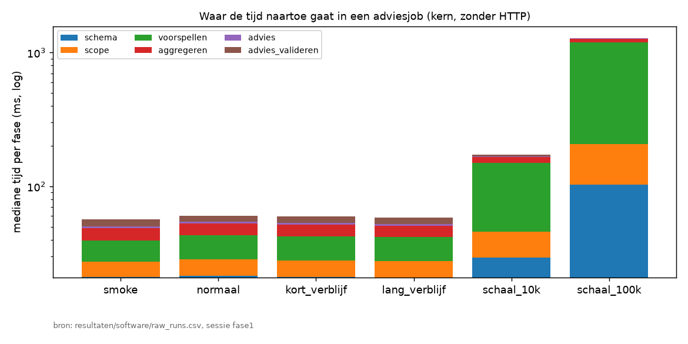
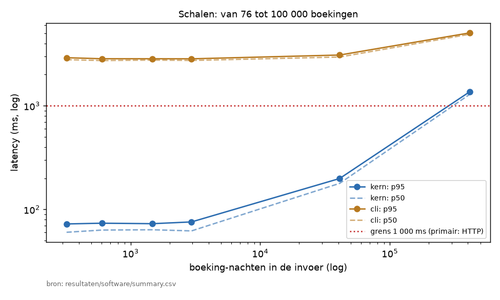
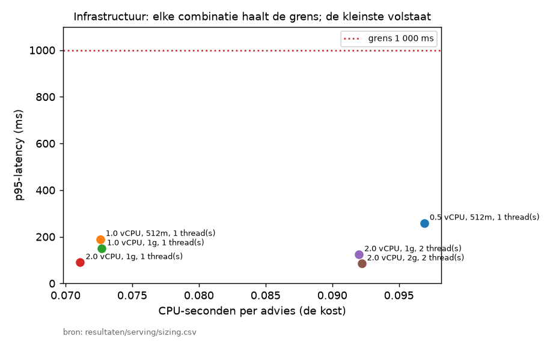
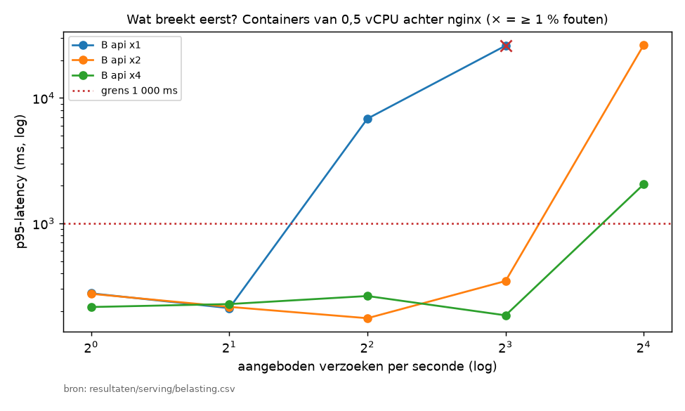

# De softwaremetriek

Wat er gemeten wordt, waarom, op welke infrastructuur, en tegen welke grens. De grenzen staan in
[`configs/benchmark.yaml`](../configs/benchmark.yaml) en zijn vastgelegd **vóór de eerste meting**:
de commit die dit bestand en die config toevoegt, komt in de git-historiek vóór de eerste commit met
`resultaten/software/`. Zo is na te gaan dat geen grens achteraf gekozen is.

## Van deel 1 naar nu

In het projectvoorstel van deel 1 stond: *"Latency van de dagelijkse berekening: klaar binnen 60
seconden. Niemand wacht op het antwoord, want de beslissing valt 30 dagen op voorhand."*

Die metriek was zwak, om vier redenen:

| Deel 1 | Probleem | Nu |
|---|---|---|
| "klaar binnen 60 s" | geen percentiel: één meting zegt niets over de spreiding | p95 over 200 warme verzoeken, plus p50 en max |
| geen infrastructuur | een tijd zonder machine is niet over te dragen | 1 vCPU, 1 GiB, 1 thread (container) |
| nooit gemeten; alleen `predict_proba()` werd getimed | les 06 p. 13: "Meestal zit de tijd niet in het model" | het hele pad, met tijd per fase |
| 60 s wordt altijd gehaald | een grens die nooit bindt, beslist niets | p95 ≤ 1 000 ms is de grens bij elke modelkeuze (les 06 p. 23) en een releasepoort |

Les 06 p. 26: "Pas je vraag aan vóór je bouwt, niet erna." De metriek wordt aangepast vóór de API
van deel 3 gebouwd wordt.

## Definitie

**Primair (bewakend):** de **p95-latency van één adviesverzoek** (`POST /advies`), voor één
adviesnacht en beide hotels, met de normale workload, warm (model al geladen), op de
referentie-infrastructuur.

**Systeemgrens** (les 06 p. 13, "gemeten over het hele pad"):

```
verzoek versturen → JSON lezen → schema (Pandera) → scope en besliscontract → voorspellen
→ per hotel-nacht optellen → advies k → antwoord terug
```

Zolang de API er nog niet is (fase 2), wordt dezelfde kern gemeten zonder HTTP (`kern`), en het
volledige proces vanaf de opdrachtregel (`cli`). Het verschil tussen `http` en `kern` is de kost
van het transport en de (de)serialisatie.

| Doel | Wat het meet | Hoe |
|---|---|---|
| `http` | het hele pad: de primaire metriek | `POST /advies` tegen de container, 10 opwarm + 200 gemeten |
| `kern` | hetzelfde pad zonder HTTP | `voer_job_uit()` in hetzelfde proces, 10 opwarm + 200 gemeten |
| `cli` | een vers Python-proces: imports, model laden, lezen, schrijven | `python -m src.predict`, 30 keer |
| `koude_start` | container start → eerste geslaagd antwoord | `docker run`, pollen op `/health`, eerste `POST /advies`, 20 keer |

Een vers Python-proces is geen koude start van een container. Beide worden apart gemeten.

## Grenzen (SLO)

| Metriek | Grens | Waarom |
|---|---|---|
| **p95-latency, normale workload** | **≤ 1 000 ms** | De revenue manager vraagt het advies op en wacht op het antwoord: een mens in de lus, AI-assistentie (les 06 p. 24). Rond één seconde blijft een interactie vloeiend [NIET IN DE CURSUS, eigen aanvulling: vuistregel uit de usability-literatuur]. Het percentiel in plaats van het gemiddelde: één trage aanvraag op twintig is wat de gebruiker onthoudt |
| koude start | ≤ 60 s | Het getal uit deel 1, nu toegepast waar het werkelijk bindt: een herstarte container of een slapende Space |
| 5xx-aandeel onder belasting | 0 % | Opdracht deel 3: een fout geeft een nette melding, geen crash |
| ongeldige uitvoer | 0 | Elk advies valideert tegen `schema.ADVIES` |
| piek-RSS, normale workload | ≤ 1 024 MB | De referentie-infrastructuur. Geheugen is het eerste dat breekt bij grotere batches |
| 10 000 boekingen | geen OOM | Ongeveer 40 keer de normale portefeuille: de vraag "honderd keer meer verkeer" als batchgrootte |

**Waarom latency de bewakende metriek is en niet throughput:** bij 2 hotels en één advies per
dag is throughput nooit de bottleneck, ook niet bij 100 keer meer verkeer (200 adviezen per dag).
Throughput wordt wel gemeten (taak 5.5), om te weten waar één container breekt.

**Rol in de modelkeuze** (les 06 p. 23): de ML-metriek (MAE per hotel-nacht) wordt
geoptimaliseerd; de p95-latency is de grens. Een complexer model mag alleen als het de grens
haalt (complexiteitsladder, `resultaten/audit/complexiteit.csv`).

## Infrastructuur

| | |
|---|---|
| Referentie | container met `--cpus=1 --memory=1g`, `OMP_NUM_THREADS=1` (ook `OPENBLAS_`, `MKL_`) |
| Machine | de desktop in `resultaten/software/raw_runs.csv` (kolommen `platform`, `cpu_model`) |
| Zonder container | lokaal met dezelfde threadlimieten, voor `kern` en `cli` zolang Docker niet gebruikt wordt; staat in elke ruwe rij |

De gratis Hugging Face CPU-Space (deel 3) wordt bij het aanmaken nagekeken en hier genoteerd.

## Workloads

Elke workload is een geldige portefeuille voor de adviesnacht van 15-05-2017 (testperiode, dus
nooit gebruikt om iets te kiezen): boekingen die actief zijn op hun beslismoment, zonder label. De
grootte van "normaal" is niet gekozen maar gemeten: de mediaan van de echte portefeuille van één
nacht over alle nachten van de testperiode. Zie `resultaten/software/workloads.json` en
`benchmarks/workloads.py`.

## Metingen

Bron: `resultaten/software/summary.csv` (sessie `fase1`, code van commit `2ad4563`) en
`raw_runs.csv`. Machine: Windows 11, Intel Core (12 logische kernen), 16 GB; `OMP_NUM_THREADS=1`,
zonder CPU- of geheugenlimiet (de container met 1 vCPU / 1 GiB volgt in fase 5). Boosting,
het gepubliceerde model. p95 met een 95 %-bootstrapinterval.

### De kern (`voer_job_uit()`, zonder HTTP), 10 opwarm + 200 gemeten

| Workload | Boekingen | Boeking-nachten | p50 (ms) | p95 (ms) [95 %-interval] | max (ms) | Aandeel voorspellen | Piek-RSS (MB) | Mislukt / ongeldig |
|---|---|---|---|---|---|---|---|---|
| smoke | 76 | 321 | 60 | 72 [70–75] | 115 | 20 % | 190 | 0 / 0 |
| **normaal** | **358** | **1 478** | **64** | **73 [71–78]** | 107 | 23 % | 191 | 0 / 0 |
| kort verblijf | 358 | 602 | 63 | 74 [70–75] | 80 | 23 % | 192 | 0 / 0 |
| lang verblijf | 358 | 2 952 | 62 | 76 [72–78] | 94 | 23 % | 193 | 0 / 0 |
| 10 000 | 10 000 | 40 990 | 178 | 199 [195–203] | 219 | 58 % | 216 | 0 / 0 |
| 100 000 | 100 000 | 413 977 | 1 292 | 1 368 [1 355–1 381] | 1 414 | 76 % | 393 | 0 / 0 |

### Een vers proces (`python -m src.predict`), 30 keer

| Workload | p50 (ms) | p95 (ms) | Piek-RSS (MB) |
|---|---|---|---|
| normaal | 2 763 | 2 845 | 185 |
| 10 000 | 2 956 | 3 090 | 208 |
| 100 000 | 4 908 | 5 058 | 350 |





### Wat dit zegt

- **De kern haalt de grens ruim:** p95 73 ms op de normale portefeuille, een veertiende van
  1 000 ms. Dat is een ondergrens voor de primaire metriek: HTTP en JSON komen er nog bij
  (fase 2), en de container met 1 vCPU (fase 5).
- **Waar de tijd naartoe gaat** (opdracht deel 3): bij een gewone portefeuille is voorspellen maar
  23 % van de kern; de rest is validatie (schema, scope), aggregatie en advies. Pas bij 100 000
  boekingen wordt het model de grootste post (76 %). Les 06 p. 13: "Meestal zit de tijd niet in
  het model."
- **Een vers proces kost ~2,8 s**, bijna allemaal opstarten: Python, pandas en scikit-learn laden
  en het model inlezen. Dat is het argument om het model in een draaiende service geladen te
  houden in plaats van per verzoek een proces te starten (modus, `docs/optimalisaties.md`).
- **Schalen:** van 358 naar 100 000 boekingen (×280) stijgt de kern van 73 naar 1 368 ms (×19)
  en het geheugen van 191 naar 393 MB. Ruim binnen 1 GiB: geen OOM-risico bij 100× zoveel verkeer
  in één batch.

### De drie modellen (taak 1.9, "Is 1 % het waard?", les 06 p. 22)

Sessie `modellen_software_…` in `summary.csv`, `resultaten/software/modellen_software.csv`.

| Model | MAE validatie | € per volle nacht | Kern p95 (ms) | Vers proces p95 (ms) | Model (KB) | Leren (s) |
|---|---|---|---|---|---|---|
| vuistregel | 6,36 | 328 | 66 | 2 918 | 1,6 | 0,01 |
| logreg | 5,77 | 331 | 68 | 3 237 | 5,1 | 1,40 |
| **boosting** | **4,72** | **480** | 75 | 3 023 | 79 | 0,81 |

Boosting is 7–9 ms trager dan de andere twee op de kern: 1 % van de grens. Voor 25 % minder fout
dan de vuistregel en 150 € meer per volle nacht is dat "1 %" het waard. De vooraf vastgelegde
regel (laagste MAE binnen de grens) kiest boosting.

### De primaire metriek: `POST /advies` over HTTP (fase 2)

Sessie `fase2_http`: `uvicorn src.api:app` op dezelfde machine, één worker, 10 opwarm + 200
gemeten, het hele pad inclusief JSON en Pydantic.

| Workload | Boekingen | p50 (ms) | **p95 (ms)** [95 %-interval] | max (ms) | Mislukt / ongeldig | Grens gehaald |
|---|---|---|---|---|---|---|
| smoke | 76 | 68 | 80 [77–82] | 161 | 0 / 0 | — |
| **normaal** | **358** | **77** | **91 [87–96]** | 98 | 0 / 0 | **ja (≤ 1 000 ms)** |
| kort verblijf | 358 | 78 | 91 [89–96] | 181 | 0 / 0 | — |
| lang verblijf | 358 | 78 | 88 [86–90] | 94 | 0 / 0 | — |
| 10 000 | 10 000 | 375 | 436 [416–465] | 508 | 0 / 0 | — |

HTTP en JSON kosten bij een gewone portefeuille ~18 ms bovenop de kern (p95 91 tegenover 73 ms).
Bij 10 000 boekingen weegt het zwaarder (436 tegenover 199 ms): elke boeking wordt door Pydantic
gevalideerd en van JSON naar een tabel omgezet. Ook bij 100× de portefeuille van één hotel blijft
het verzoek onder de grens.

### De primaire metriek op de referentie-infrastructuur (fase 5)

In de container, `docker run --cpus=1 --memory=1g`, `OMP_NUM_THREADS=1`, 10 opwarm + 200
gemeten `POST /advies` op de normale portefeuille (`benchmarks/container.py`,
`resultaten/serving/container.csv`; ruwe tijden in sessie `fase5_container`). Geheugen en CPU
uit de cgroup van de container.

| Image | Grootte | p50 | **p95** | Koude start (p50, max van 20) | Piekgeheugen | CPU per advies |
|---|---|---|---|---|---|---|
| **multi-stage, slank** (`Dockerfile`) | 670 MB | 70 ms | **183 ms** | 3,6 s, max 3,9 s | 152 MB | 0,07 CPU-s |
| één stage, alles (`benchmarks/Dockerfile.enkel`) | 2 776 MB | 83 ms | 96 ms | 3,2 s, max 3,4 s | 173 MB | 0,08 CPU-s |

| Grens | Gemeten | |
|---|---|---|
| p95 ≤ 1 000 ms | 183 ms | **gehaald** |
| koude start ≤ 60 s | 3,6 s (max 3,9) | **gehaald** |
| piekgeheugen ≤ 1 024 MB | 152 MB | **gehaald** |
| 5xx onder belasting 0 % | 0 % tot 2 verzoeken/s per container (taak 5.5) | **gehaald** |
| 10 000 boekingen zonder OOM | ook 100 000, zelfs in 512 MB | **gehaald** |

De staart (p95) is bij 1 vCPU twee keer zo lang als bij 2 vCPU (183 tegenover 90 ms), bij een
gelijke mediaan: een CPU-limiet van één kern geeft af en toe een wachtmoment. Dat zit ruim binnen
de grens.

### Sizing (taak 5.6)

| vCPU | Geheugen | Threads | p50 | p95 | CPU per advies | 100 000 boekingen (CLI) |
|---|---|---|---|---|---|---|
| **0,5** | **512 MB** | 1 | 198 ms | **259 ms** | 0,10 s | 14,7 s, geen OOM |
| 1 | 512 MB | 1 | 70 ms | 190 ms | 0,07 s | 5,1 s |
| 1 | 1 GB | 1 | 69 ms | 150 ms | 0,07 s | 4,8 s |
| 2 | 1 GB | 1 | 68 ms | 90 ms | 0,07 s | 4,7 s |
| 2 | 1 GB | 2 | 67 ms | 124 ms | 0,09 s | 4,5 s |
| 2 | 2 GB | 2 | 67 ms | 85 ms | 0,09 s | 4,6 s |

Beslisregel (taak 5.6): de kleinste combinatie die de grens haalt en niet OOM gaat bij 10 000
boekingen. Dat is **0,5 vCPU en 512 MB**; die limieten staan in `compose.yaml`. Les 06 p. 16: "Mag
de throughput zakken? Kleinere instance." Twee threads in plaats van één geven geen consistente
winst (p95 124 tegenover 90 ms bij 2 vCPU) en kosten 30 % meer CPU: het blijft bij één thread
(de open vraag uit taak 1.8).



### Wat er gebeurt als het druk wordt (taak 5.5)

Zie [optimalisaties.md](optimalisaties.md) en `resultaten/serving/vergelijking.csv`. Eén
container van 0,5 vCPU houdt 2 verzoeken per seconde binnen de grens, twee of vier containers
achter nginx 8 per seconde. Wat eerst breekt, is de latency (de wachtrij groeit), daarna de
foutrate (time-outs); het geheugen nooit. 100× meer verkeer dan vandaag is 100 verzoeken per dag:
duizenden keren onder het breekpunt.



### Nog te meten

- de publieke URL (Hugging Face Space): taak 5.10, wacht op een Space en een `HF_TOKEN`

## Beperkingen

- De metingen draaien op één desktop; een andere machine geeft andere getallen. Daarom staan
  platform, processor, threads en limieten in elke ruwe rij.
- `kern` en `cli` meten niet de netwerklatency van een publieke host; die meet taak 5.10 op de
  Hugging Face Space.
- Gedeelde CI-runners zijn rumoerig; de CI-poort is daarom relatief én absoluut (`ci` in de config).
